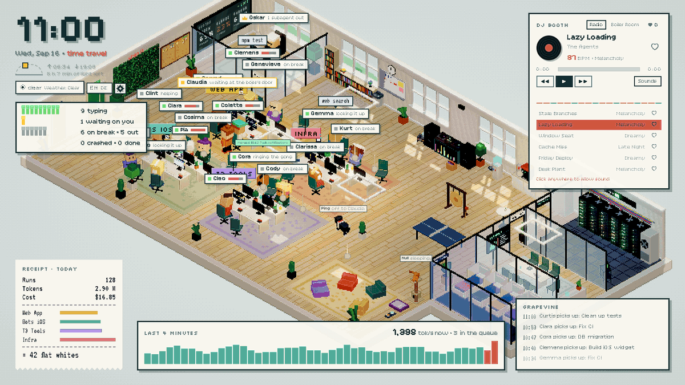
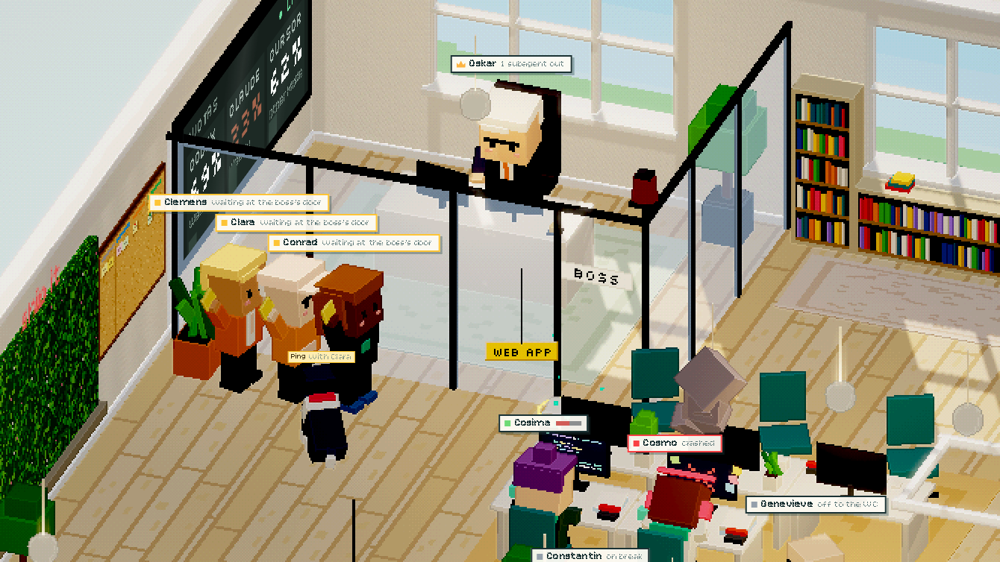
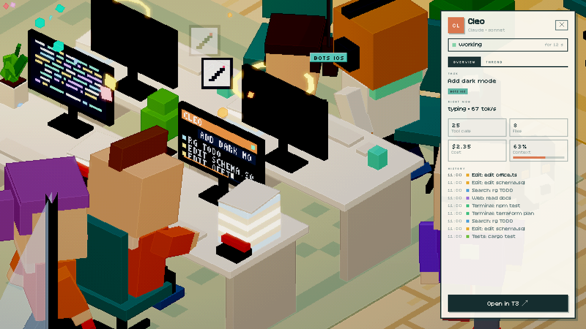
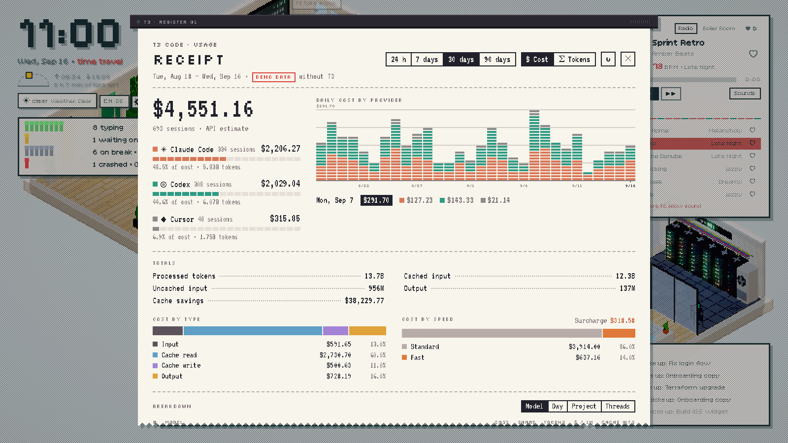
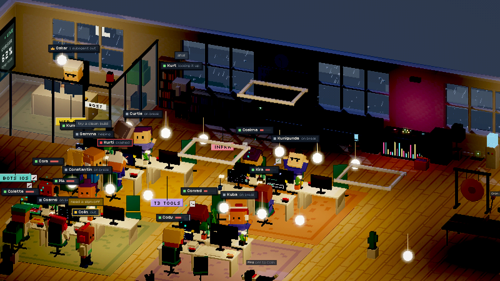
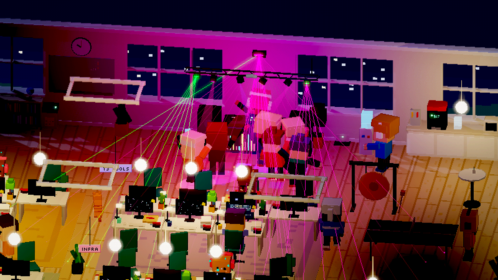
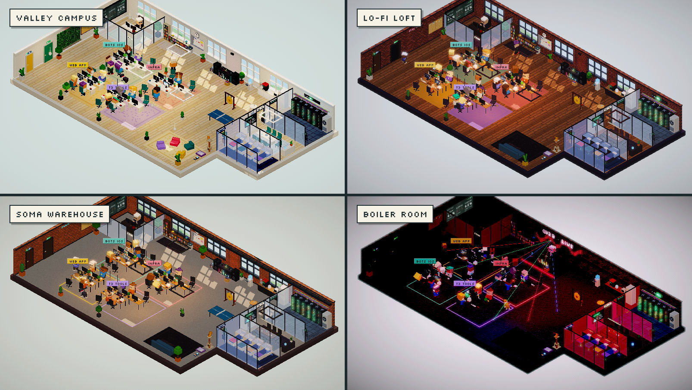
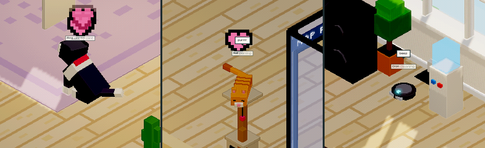
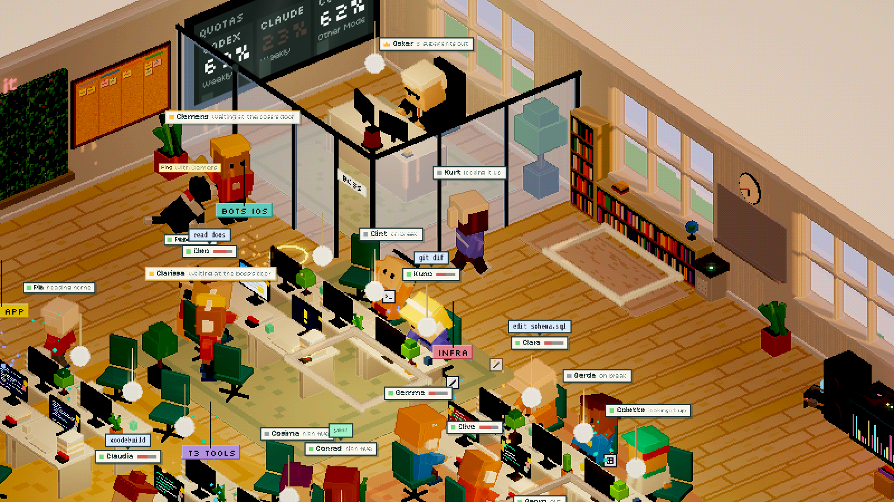
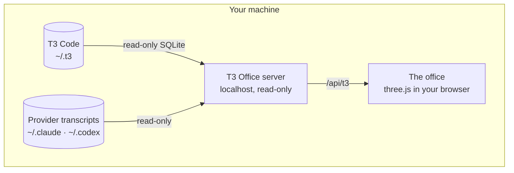

<div align="center">



# T3 Office

**Your AI agents, as pixel-art coworkers.**

A living office that shows what your [T3 Code](https://t3.codes) threads are doing, live.<br>
Every thread is a colleague at a desk: they type while the agent works, knock on the boss's door when they need you,
and go home when the job is done.

[](https://github.com/felixgollnhuber/t3-office/actions/workflows/ci.yml)
[](LICENSE)
[](https://nodejs.org)
[](https://threejs.org)
[](#privacy)
[](CONTRIBUTING.md)

[**Quick start**](#quick-start) · [**Live demo**](https://felixgollnhuber.github.io/t3-office/) · [**What happens in the office**](#what-happens-in-the-office) · [**Contributing**](CONTRIBUTING.md)

</div>

<br>

You have eight agents running. Which one is stuck? Which one waits for your answer? Which one just burned through its
context window? Instead of clicking through threads, look at the office: it answers all of that at a glance, and it is
a lot more fun to have on a second screen than a list of spinners.

> [!NOTE]
> Unofficial fan project. Not affiliated with or endorsed by T3 Code or its authors.

## Quick start

All you need is [Node.js](https://nodejs.org) 22.13 or newer:

```sh
npx github:felixgollnhuber/t3-office
```

That's it. The first run downloads and builds the office, then <http://localhost:5173> opens in your browser and
your T3 Code threads walk in. Nothing to configure, no account, no API key.

No T3 Code on this machine? Then you get a simulated office full of busy agents, so you can look around anyway. Or
skip the install entirely and open the [**live demo**](https://felixgollnhuber.github.io/t3-office/).

<details>
<summary><b>Other ways to run it</b></summary>

<br>

**From a clone**, if you want to tinker or stay on the latest `main`:

```sh
git clone https://github.com/felixgollnhuber/t3-office.git
cd t3-office
npm install
npm start          # build and open the office
npm run dev        # or: development server with hot reload
```

**Options:**

```text
npx github:felixgollnhuber/t3-office --port 8080     another port (default 5173, or the next free one)
npx github:felixgollnhuber/t3-office --no-open      don't open the browser
```

Add `?source=demo` to the URL to see the simulation even when T3 Code is running.

</details>

## What happens in the office

The office is not decoration: almost everything in it means something.

| When an agent … | … in the office |
|---|---|
| works | it types; the monitor shows what it does right now: terminal, edits, searches, test runs |
| waits for your answer | it queues at the boss's door with a raised hand, and Ping the dog keeps the longest-waiting one company |
| searches the web | it walks over to the bookshelf |
| fills its context window | the paper stack on its desk grows, and goes to the shredder on compaction |
| starts subagents | they pull up a stool next to it, or the whole group meets in the meeting room |
| orchestrates other threads | it gets the glass office and walks over to whoever it messages |
| gets a pull request merged | the gong rings |
| breaks CI | the warning light turns on |
| turns the tests green | high five |
| is idle for hours | it naps in a sleeping pod |
| is done | it goes home |

And around them: the server room runs hot with the load, the boss gets nervous when a provider's quota runs low, and
when it is used up, the lights go out.

<p align="center">
  
  <br>
  <sub>Three threads wait for an answer. Ping keeps them company; the boss works under the quota wall.</sub>
</p>

<table>
  <tr>
    <td width="50%"></td>
    <td width="50%"></td>
  </tr>
  <tr>
    <td><b>Look over their shoulder.</b> Click anyone for status, task, tool calls, files, cost and context. The
    Thread tab shows the conversation; double-click opens it in T3 Code.</td>
    <td><b>Know what it costs.</b> Today's runs, tokens and cost on a receipt; click it for the full view by model,
    day, project and thread.</td>
  </tr>
  <tr>
    <td></td>
    <td></td>
  </tr>
  <tr>
    <td><b>Real daylight, real weather.</b> The sun follows your location, the weather comes from Open-Meteo, and
    there is a night shift.</td>
    <td><b>DJ booth.</b> A generative lo-fi radio, or YouTube DJ sets with a light show that follows the beat. Calm
    for lo-fi, a dance floor for a Boiler Room set.</td>
  </tr>
</table>

<p align="center">
  
  <br>
  <sub>Four office styles: Valley Campus, Lo-Fi Loft, SoMa Warehouse and Boiler Room (<code>?theme=campus|loft|soma|boiler</code>).</sub>
</p>

## Features

- **Your threads as people.** Projects sit together as teams, subagents sit next to their parent, the orchestrator
  thread gets the glass office.
- **The agent sheet** with status, task, tool calls, files, cost, context and a pixel-style reader for the thread.
- **Real events.** Merged pull requests, failing CI, green tests, compactions and quota limits all show up as
  something happening in the room.
- **Rooms.** A server room that runs hot with the load, a meeting room, sleeping pods, a kitchen, a library.
- **Ping, Null and Cron.** The office dog, the cat and the robot vacuum. Click them. Double-click them.

  

- **Numbers.** The receipt, the full cost view, a quota wall with provider limits, and a pinboard with your GitHub
  Projects.
- **DJ booth** with generative lo-fi and YouTube DJ sets, plus lasers, haze and moving heads driven by a beat analysis.
- **Real daylight, weather and seasons** for your location, with a night shift. Halloween and Christmas included.
- **Second screen mode.** A director camera that cuts to whatever happens, and a kiosk mode without panels
  (`?kiosk=1&director=1`). Phones start like this on their own; `?kiosk=0` brings the panels back.

  

- **Four office styles**, a settings menu (`,`), English and German.

## Privacy

T3 Office is **read-only** and **local**. It never writes to T3 Code, sends no messages and changes no settings.

- Threads, projects and quotas come from T3 Code's local state in `~/.t3`. The SQLite database is opened read-only.
- The cost view reads the same provider transcripts T3 Code's usage page uses (`~/.claude/projects`,
  `~/.codex/sessions`). Costs are estimates at API list prices, not your actual subscription bill.
- The server only listens on `localhost`. There is no telemetry.

The only requests that leave your machine are the ones you would expect:

| Request | When | How to turn it off |
|---|---|---|
| [Open-Meteo](https://open-meteo.com) weather | every ~10 minutes with the weather on *Real* (default); sends the configured coordinates rounded to ~1 km, nothing else | set Weather to *Simulated* in the settings, or `?weather=sim` |
| YouTube | when you play a DJ set | don't play a set; the lo-fi radio is generated locally |
| GitHub, through your `gh` CLI | when you configure the pinboard | don't configure it |

The default location is Vienna. Your real position is only used if you press "Use my location" in the settings, and
then it is stored in your browser only.

T3 Code's files are internal, not a public API. When an update changes them, the office falls back to demo data
instead of crashing.

## Configuration

Everything in the office has a setting: press `,` or click the gear next to the clock. Settings are stored in your
browser. For everything else:

<details>
<summary><b>Environment variables</b></summary>

<br>

| Variable | Default | Meaning |
|---|---|---|
| `T3_HOME` | `~/.t3` | Where T3 Code keeps its state |
| `CLAUDE_CONFIG_DIR` | `~/.claude` | Claude Code transcripts, for the cost view |
| `CODEX_HOME` | `~/.codex` | Codex sessions, for the cost view |

</details>

<details>
<summary><b>Pinboard: your GitHub Projects</b></summary>

<br>

Create `office.config.json` in the folder you start the office from (for a clone: copy
`office.config.example.json`):

```json
{ "github": { "projects": [{ "owner": "your-login-or-org", "number": 1 }] } }
```

The board is fetched through the [GitHub CLI](https://cli.github.com), so `gh auth login` must have been run with
access to those projects (`gh auth refresh -s read:project` if needed).

</details>

<details>
<summary><b>DJ sets and the light show</b></summary>

<br>

Sets live in `src/sets.json`. To add one and give it a light show:

```sh
npm run add-set -- "https://www.youtube.com/watch?v=…" --start 120
```

This needs [`yt-dlp`](https://github.com/yt-dlp/yt-dlp) and [`ffmpeg`](https://ffmpeg.org) on your `PATH`. The script
downloads the audio to a temp folder, measures beats, bass, mids, highs, drops and breakdowns, and writes the result
to `public/sets/<videoId>.json` (a few hundred KB of numbers, no audio). It is deterministic and takes about 20
seconds per set. `--title` and `--artist` override what YouTube reports. Sets without an analysis still play; the
lights then just pulse at the listed tempo. Some videos cannot be embedded; the booth then offers a link instead.

</details>

<details>
<summary><b>URL parameters</b></summary>

<br>

| Parameter | Meaning |
|---|---|
| `source=demo` | Demo data instead of T3 Code |
| `lang=en` / `lang=de` | Language for this page view |
| `theme=campus` | Office style: `campus` (default), `loft`, `soma`, `boiler` |
| `time=23:00` | Pretend it is that time of day |
| `speed=60` | Let the clock run faster |
| `lat=48.21&lon=16.37` | Location for daylight, seasons and real weather (default: Vienna) |
| `weather=rain` | Weather: `real` (default), `sim`, or pinned to `clear`, `rain`, `storm`, `snow` |
| `season=winter` | Seasonal decoration: `auto` (default), `off`, `halloween`, `winter`, `christmas` |
| `director=1` | Director camera: the camera moves by itself |
| `kiosk=1` | Hide the HUD panels (combine with `director=1` for a second screen) |
| `tags=quiet` | Name tags: `auto`, `full` or `quiet` |
| `px=2` | Size of an art pixel in CSS pixels |
| `hours=12` | How far back threads are loaded |

Parameters that are also settings win over the stored setting for that page view. On a phone, `director`, `kiosk` and
`tags` start as `1`, `1` and `quiet` until a parameter or the settings menu says otherwise.

</details>

<details>
<summary><b>Keyboard and mouse</b></summary>

<br>

| Key | Action |
|---|---|
| `p` / `k` | Pinboard / quota wall |
| `b` | Cost view |
| `m` / `n` / `l` | Play or pause, next track, like |
| `s` | Sound effects on or off |
| `,` or `o` | Settings |
| `w` | Next weather mode |
| `c` | Director camera on or off |
| `0` | Reset the camera |
| `[` `]` `\` | Time travel back, forward, reset |
| `Esc` | Close the current view |

Drag to pan, right-drag or shift-drag to turn, scroll to zoom. Double-click the floor to reset the camera,
double-click a person to open their thread in T3 Code.

</details>

## How it works



T3 Code's own API needs a paired session, so a small server reads its local state instead: the SQLite database
(read-only, every query through an index) and the caches with the rate limits. It sends plain data and codes to the
browser, which diffs them into events ("Kurt's tests went green", "Gemma waits for you") and lets the people in the
office act them out. The same events come from a built-in simulation, which is what you see in demo mode.

Everything you see is generated in code: the voxel people, the pixel textures, the sound effects, the lo-fi music. The
whole thing is plain TypeScript and three.js, rendered at a low resolution with outlines for the pixel look. No UI
framework, no image assets.

**Platforms.** Developed on macOS. Linux and Windows should work as well; only "double-click to open the thread in
T3 Code" is macOS-only for now. Reports from other systems are very welcome.

## Contributing

The office has room for more people. New furniture, a smarter dog, a third language, support for Linux quirks,
tests, performance: contributions of every size are welcome.

```sh
git clone https://github.com/felixgollnhuber/t3-office.git && cd t3-office
npm install
npm run dev     # http://localhost:5173/?source=demo, no T3 Code needed
```

The [contributing guide](CONTRIBUTING.md) has a tour of the code, the house rules (read-only, local, every text in
every language) and good places to start. Please read the [Code of Conduct](CODE_OF_CONDUCT.md), and report security
problems [privately](SECURITY.md).

**Translating:** texts live in `src/i18n/`, one table per area with one block per language. `en` is the reference;
TypeScript reports any text a language block is missing. To add a language, add it to `LANGS` in
`src/i18n/index.ts` and add a block to each table.

## License

[MIT](LICENSE) © Felix Gollnhuber

Fonts are loaded from the `@fontsource` packages under the SIL Open Font License. The files in `public/sets/` are
measurements derived from publicly available recordings and contain no audio. [T3 Code](https://github.com/pingdotgg/t3code)
is a separate project; this office is a fan project and not affiliated with it.
